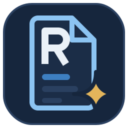

  

<h1 align="center">RenAImer</h1>

  <strong>Dokumente, Scans und Fotos automatisch umbenennen.</strong> 
  Gratis für Windows · Version 4.10 · von <a href="https://mhaase.ch">mhaase software</a>

  <a href="https://github.com/mhaase-software/RenAImer/releases/latest"><strong>⬇ Download</strong></a> ·
  <a href="https://mhaase.ch/renaimer/">Website</a> ·
  <a href="https://mhaase.ch/renaimer/#faq">Häufige Fragen</a>

---

RenAImer liest Briefe, PDFs, Fotos und Office-Dateien, erkennt **Datum, Absender und Thema** und gibt jeder Datei einen Namen, den du wiederfindest. Die Erkennung übernimmt die KI Claude von Anthropic.

| Vorher | Nachher |
|---|---|
| `Scan_0042.pdf` | `2026-10-15_Swisscom_Rechnung-Oktober.pdf` |
| `IMG_4711.jpg` | `2026-07-14_Sonnenuntergang-Thunersee.jpg` |
| `Dokument (3).pdf` | `2026-05-20_Krankenkasse_Praemienverbilligung.pdf` |
| `Mappe1.xlsx` | `0000-00-00_Budget-2027.xlsx` |

  

## Funktionen

- **Datum, Absender, Thema** – das Datum kommt aus dem Dokument selbst, nicht aus dem Änderungsdatum der Datei.
- **Fotos oder Dokument?** – bei Bildern erkennt die KI selbst, ob es ein abfotografierter Brief oder ein Foto ist.
- **Stichwörter in der Datei** – Titel, Zusammenfassung und Stichwörter landen in den Datei-Eigenschaften. Die Windows-Suche findet sie.
- **Vorschau und Kontrolle** – jeden Vorschlag prüfen und bei Bedarf per Doppelklick ändern, bevor etwas passiert.
- **Rückgängig und Protokoll** – `Ctrl+Z` holt Dateien mit altem Namen zurück. Jede Verschiebung steht im Protokoll.
- **Nichts wird überschrieben** – gibt es den Namen schon, kommt `_2`, `_3` usw. dazu.
- **Drag & Drop**, **Drucken** und **helles oder dunkles Farbschema**.

## Unterstützte Formate

| Gruppe | Formate |
|---|---|
| PDF | PDF |
| Bilder | JPG, PNG, HEIC (iPhone), TIFF (auch mehrseitig), WEBP, BMP, GIF |
| Office | DOCX, XLSX, PPTX |
| LibreOffice | ODT, ODS, ODP |
| E-Mail | EML, MSG (Outlook) |
| Text | TXT, CSV, RTF, MD, JSON, XML, LOG |
| Kontakte, Termine | VCF, ICS |

Nicht möglich: alte Office-Dateien (DOC, XLS, PPT), Apple Pages/Numbers, ZIP, Videos, Musik.

## Download und Installation

Unter [**Releases**](https://github.com/mhaase-software/RenAImer/releases/latest) oder auf [mhaase.ch/renaimer](https://mhaase.ch/renaimer/#download):

- **RenAImer-Setup-4.10.exe** – empfohlen, installiert RenAImer mit Startmenü-Eintrag
- **RenAImer-4.10.msi** – für Verteilung per Gruppenrichtlinie oder Softwareverteilung

RenAImer ist nicht digital signiert. Windows SmartScreen zeigt deshalb beim ersten Start eine Warnung: **Weitere Informationen → Trotzdem ausführen**. Die SHA-256-Prüfsummen stehen bei jedem Release.

**Systemvoraussetzungen:** Windows 10 oder 11 (64 Bit), Internetverbindung, Administratorrechte für die Installation.

## API-Schlüssel und Kosten

RenAImer ist gratis. Für die Erkennung brauchst du einen eigenen API-Schlüssel von Anthropic:

1. Konto auf [platform.claude.com](https://platform.claude.com) erstellen
2. Guthaben aufladen (Prepaid, du zahlst nur, was du verbrauchst)
3. Schlüssel erzeugen und beim ersten Start von RenAImer einfügen

Mit dem Modell Haiku kostet eine Datei Bruchteile eines Rappens. Ein Claude-Abo brauchst du nicht.

## Datenschutz

- RenAImer schickt den Inhalt jeder Datei zur Erkennung an die Claude-API von Anthropic (USA). Bei Word, Excel und Textdateien nur den Text.
- mhaase software erhält keine Dateien, Dateinamen oder Nutzungsdaten.
- Dein API-Schlüssel wird mit Windows-Verschlüsselung gespeichert. Nur dein Windows-Konto kann ihn lesen.

Benenne nur Dokumente um, bei denen das für dich in Ordnung ist.

## Fragen und Kontakt

- Häufige Fragen: [mhaase.ch/renaimer/#faq](https://mhaase.ch/renaimer/#faq)
- Fehler gefunden oder eine Idee? [Issue eröffnen](https://github.com/mhaase-software/RenAImer/issues) oder an kontakt@mhaase.ch schreiben.

---

RenAImer ist Freeware. Der Quellcode ist nicht öffentlich.
Die Software wird ohne Gewähr zur Verfügung gestellt.

© 2026 [mhaase software](https://mhaase.ch) · Gut zugehört. Gut gebaut.
